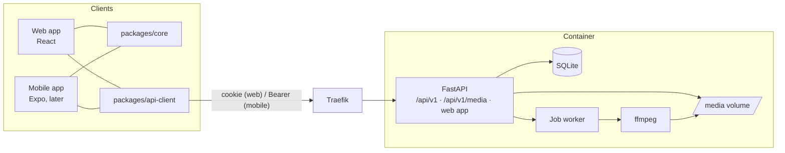

# Signa

Signa is a practice tool for students of Flemish Sign Language (Vlaamse Gebarentaal, VGT):
practise the signs from your course, by year, lesson or list.

- **Students** join their group with an invite link, practise in both directions
  (word → sign, sign → word) with “Kende ik” / “Kende ik niet”, repeat what they missed,
  browse the dictionary and practise their difficult words. No email, no real name.
  When a video is wrong (another sign, a bad start or end…) they report it with a comment.
- **Teachers** manage the word list with drafts, history and undo, upload and trim clips, and
  record whole lessons at once: the app splits a long video on the rests between signs, the
  teacher adjusts the cuts on a timeline, matches each part to a word or makes it a new word,
  and chooses to replace the old clip or add an extra one.
  Reported problems with videos are listed under “Meldingen”, next to each clip, until resolved.
- **Groups** are a course year plus a weekday (“Jaar 1 · dinsdag”). Teachers move students
  between groups, one by one or a whole group at the start of the year. Every move is logged.
  A word can be limited to some groups, so groups can have the same list number with another
  video or another set of words.
- **Schools** each have their own words, groups, recordings and members, and teach one sign
  language. Nothing is shared between schools. One account can be in several schools (with a
  role in each) and in several groups; a switcher in the header picks the school and group.
- **Languages:** the app speaks Dutch, French and English. It follows the school's sign
  language (LSFB: French) unless the user chooses another language in their profile.

See [docs/PLAN.md](docs/PLAN.md) for the plan and roadmap.

## Architecture

```
apps/api              FastAPI · SQLAlchemy 2.0 · Alembic · SQLite · ffmpeg
apps/web              React 19 · Vite · TanStack Router + Query · Tailwind v4 (students + /admin)
apps/mobile           Expo, placeholder until milestone 9
packages/api-client   TypeScript client generated from the OpenAPI schema
packages/core         shared logic: deck building, practice session reducer, Dutch UI text
```



One container serves the API, the protected videos (with range requests) and the built web
app. A worker thread in the same process converts uploads and splits recordings.

## Development

Needs Python 3.12+, [uv](https://docs.astral.sh/uv/), Node 22, pnpm and ffmpeg.

```bash
make install
make demo        # demo users, group and words
make api         # http://localhost:8000 (API docs at /api/docs)
make web         # http://localhost:5173, proxies /api to :8000
```

Demo logins: `student` / `demo-student` (in two schools), `docent` / `demo-docent`,
`admin` / `demo-admin` (superadmin). Invite links: `http://localhost:5173/join/demo` and
`/join/demo-2` (the second school).

```bash
make lint typecheck test   # ruff, pyright, pytest, eslint, tsc, vitest
make e2e                   # Playwright, against a fresh demo database
make api-client            # after changing the API: regenerate the TypeScript client
```

## Deploying

Two environments run the same image, each behind Traefik with its own database and videos:

- **DEV**: every commit on `main` is deployed automatically once CI passed.
- **PRO**: publish a GitHub release (`v1.2.0`); it is deployed the next night. To deploy
  right away: `make deploy-pro REF=<tag or sha>`.
  PRO only accepts an image that already ran in DEV; it is never rebuilt.

Each deploy backs up the database, waits for the health check and rolls back if the new
version does not start. Setup, secrets, backups and restores: [docs/DEPLOY.md](docs/DEPLOY.md).
The very first PRO deploy, step by step: [docs/FIRST-PRO-DEPLOY.md](docs/FIRST-PRO-DEPLOY.md).

Import the old app into PRO (try it in DEV or on a copy first):

```bash
docker compose -p signa-pro --env-file .env.pro exec signa signa import-legacy /data/legacy/lexicon.db /data/legacy/videos --org school --dry-run
```

## License

The code is licensed under the [GNU Affero General Public License v3.0](LICENSE).

The sign videos used in class are not part of this repository and are not covered by this
license. They belong to the teacher or school. The demo videos are published separately as a
release asset under CC BY-NC-ND 4.0.
