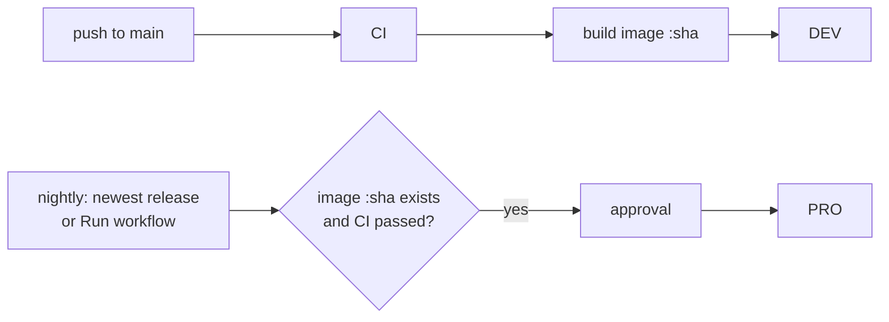

# Deploying: DEV and PRO

There are two deployments of the same image:

| | DEV | PRO |
|---|---|---|
| Purpose | try every change before it reaches students | the real app |
| URL (example) | `vgt-dev.arnedb.be` | `vgt.arnedb.be` |
| Deployed | automatically, every commit on `main` after CI passed | at night, when there is a new release; or by hand right away |
| Image | built from the commit as `:<sha>`, tagged `:dev` once it runs | the **same** `:<sha>` image, tagged `:pro` once it runs. Never rebuilt |
| Data | own database and videos; demo data when empty | own database and the class videos |
| In the app | yellow “Testomgeving (DEV)” bar, `[DEV]` in the tab title | nothing extra |

A commit can only reach PRO after it ran in DEV, because PRO refuses to deploy a commit that
has no image yet. Every deploy also checks that CI passed for that commit and that the commit
is on `main`.



## Nightly PRO deploy

Every night at 01:30 UTC (02:30 in Brussels in winter, 03:30 in summer; GitHub often starts
scheduled runs some minutes late) the Deploy workflow looks for the newest **published**
release whose tag starts with `v` (for example `v1.3.0`):

- if PRO already runs it, the run stops after a few seconds and nothing changes;
- otherwise it deploys that release to PRO, with the same checks, backup and rollback as
  any deploy.

Draft releases, pre-releases and other releases (such as `demo-media-v1`) are never
deployed at night. "What PRO runs" is the `:pro` image tag, which only moves after a
successful PRO deploy, so a failed deploy is simply tried again the next night.

If the `pro` environment has required reviewers, the nightly deploy waits for an approval,
so it only goes out at night if someone approves it then. To deploy fully unattended,
remove the required reviewers and treat publishing the release as the approval.

GitHub turns off scheduled workflows in a public repository after 60 days without any
commits; turn it back on under *Actions → Deploy*.

## What a deploy does on the server

`deploy/deploy.sh <dev|pro> <image>`, run by the workflow over SSH:

1. backs up the database (`vgt backup`, kept in the `/data/backups` folder of the volume),
2. writes the new image into `.env.<env>`, pulls it and restarts the container, which runs
   the database migrations on startup,
3. waits for the container health check,
4. if it does not become healthy, rolls back to the previous image.

Then the workflow checks that `https://<host>/api/v1/health` reports the new commit and the
right environment.

Each environment is its own Compose project (`vgt-dev`, `vgt-pro`), so the two have separate
containers, volumes and Traefik routers and can share one server.

> A rollback restarts the old image on the current database. If the new release changed the
> database schema, also restore the backup from step 1 (see [Backups](#backups)).

## One-time setup

### Server

For each environment (or once, if both are on the same server):

1. Docker with the Compose plugin, and Traefik on an external Docker network named `traefik`
   with a `websecure` entrypoint and a `letsencrypt` cert resolver (for other names, set
   `TRAEFIK_NETWORK`, `TRAEFIK_ENTRYPOINT`, `TRAEFIK_CERTRESOLVER` in the env file).
2. DNS records for both hosts pointing to the server.
3. A deploy user that may run `docker`, with the workflow's public SSH key in
   `~/.ssh/authorized_keys`.
4. A deploy folder, e.g. `/srv/vgt`. Every deploy copies `compose.yaml`, `deploy.sh` and the
   env examples there. Before the first deploy, create the env files in that folder:

   ```bash
   cp env.dev.example .env.dev   # then set VGT_HOST
   cp env.pro.example .env.pro   # then set VGT_HOST
   ```

   (Copy the examples from `deploy/` in this repository for the very first time.)
5. Let the server download the image. GitHub makes a new package **private**, so the first
   deploy fails with `error from registry: denied`. Either:
   - make it public (the image holds only the open-source code, never class videos):
     GitHub → your profile → **Packages** → `vgt-practice` → **Package settings** →
     **Change visibility** → Public; or
   - keep it private and, as the deploy user on the server, run `docker login ghcr.io -u <github user>`
     with a classic personal access token that has only `read:packages`.

### GitHub

**Settings → Environments**: create `dev` and `pro`.

- `pro`: limit deployment branches and tags to `main` and `v*`. Optionally add **required
  reviewers** (an approval before every PRO deploy; see [Nightly PRO deploy](#nightly-pro-deploy)
  for what that means at night).
- In **each** environment add:

| Kind | Name | Value |
|---|---|---|
| variable | `VGT_HOST` | `vgt-dev.arnedb.be` / `vgt.arnedb.be` |
| variable | `DEPLOY_HOST` | server name or IP |
| variable | `DEPLOY_USER` | deploy user, e.g. `deploy` |
| secret | `DEPLOY_SSH_KEY` | private key of the deploy user |
| secret | `DEPLOY_KNOWN_HOSTS` | output of `ssh-keyscan <server>` |
| variable | `DEPLOY_PATH` | deploy folder, e.g. `/opt/sites/vgt-practice` |

`DEPLOY_HOST`, `DEPLOY_USER` and `DEPLOY_PATH` may also be secrets; the workflow reads either.
GitHub hides a secret's value everywhere in the logs, so a short value like `deploy` makes the
logs hard to read: prefer variables for these three. The SSH key and known hosts are always
secrets, and the deploy stops early with a clear message when one of these settings is missing.

Secrets live only in GitHub and in the server's `.env.*` files, never in this repository.

### First admin and first school

```bash
docker compose -p vgt-pro --env-file .env.pro exec vgt vgt create-admin <username>
docker compose -p vgt-pro --env-file .env.pro exec vgt vgt create-org "CVO Gent" --language vgt --admin <teacher>
```

`create-admin` makes a superadmin, who manages the schools (*Beheer → Scholen*) and acts as
admin in each of them. `create-org` makes a school; `--admin` names its first admin (an
existing account, or a new one with a temporary password). Schools can also be created in
the web app. A database from before schools existed is moved into one school, “School”,
by the migration; rename it under *Beheer → Scholen*.

DEV starts with the demo data when its database is empty: two schools, and the users
`admin` / `demo-admin` (superadmin), `docent` / `demo-docent` and `student` / `demo-student`
(a student in both schools).

## Day to day

- **DEV**: merge to `main` and watch *Actions → Deploy*.
- **PRO**: publish a release on GitHub (e.g. tag `v1.2.0` on a commit that already runs in
  DEV). It goes to PRO the next night. To deploy right away, start it by hand:

  ```bash
  make deploy-pro REF=v1.2.0
  ```

  (`gh workflow run deploy.yml -f environment=pro -f ref=v1.2.0`)
- **Roll back PRO**: deploy an older release or commit the same way,
  `make deploy-pro REF=<old sha>`. Also mark the bad release as a pre-release (or delete it),
  otherwise the next night deploys it again.
- **Put an older commit on DEV**: `make deploy-dev REF=<sha>`.

## Backups

`vgt backup` makes a consistent copy of the SQLite database while the app runs, in
`/data/backups`, and keeps the newest `VGT_BACKUP_KEEP` copies. Every deploy makes one. For
daily backups, add a cron job on the server, and copy the backups folder and `/data/media`
off the server:

```cron
15 3 * * * cd /srv/vgt && docker compose -p vgt-pro --env-file .env.pro exec -T vgt vgt backup --label daily
```

To restore a backup: stop the container, copy the backup file over `/data/vgt.db` in the
volume (`vgt-pro_data`), delete the `vgt.db-wal` and `vgt.db-shm` files next to it, and start
the container again.

## Copying PRO data to DEV

Only when needed for testing, and remember that DEV then holds real student accounts: copy a
PRO backup from volume `vgt-pro_data` to `/data/vgt.db` in volume `vgt-dev_data` while DEV is
stopped, the same way as a restore.
