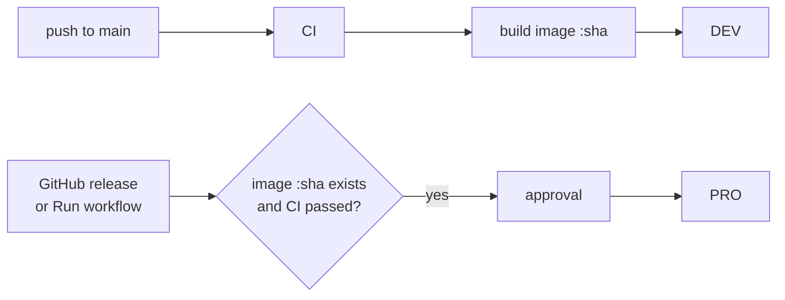

# Deploying: DEV and PRO

There are two deployments of the same image:

| | DEV | PRO |
|---|---|---|
| Purpose | try every change before it reaches students | the real app |
| URL (example) | `vgt-dev.arnedb.be` | `vgt.arnedb.be` |
| Deployed | automatically, every commit on `main` after CI passed | on a published GitHub release, or by hand |
| Image | built from the commit, tagged `:<sha>` and `:dev` | the **same** `:<sha>` image, retagged `:pro`. Never rebuilt |
| Data | own database and videos; demo data when empty | own database and the class videos |
| In the app | yellow “Testomgeving (DEV)” bar, `[DEV]` in the tab title | nothing extra |

A commit can only reach PRO after it ran in DEV, because PRO refuses to deploy a commit that
has no image yet. Every deploy also checks that CI passed for that commit and that the commit
is on `main`.



## What a deploy does on the server

`deploy/deploy.sh <dev|pro> <image>`, run by the workflow over SSH:

1. backs up the database (`vgt backup`, kept in the `/data/backups` folder of the volume),
2. writes the new image into `.env.<env>`, pulls it and restarts the container, which runs
   the database migrations on startup,
3. waits for the container health check,
4. if it does not become healthy, rolls back to the previous image.

Then the workflow checks that `https://<host>/api/v1/health` reports the new commit and the
right environment.

Each environment is its own Compose project (`vgt-dev`, `vgt-pro`), so the two have separate
containers, volumes and Traefik routers and can share one server.

> A rollback restarts the old image on the current database. If the new release changed the
> database schema, also restore the backup from step 1 (see [Backups](#backups)).

## One-time setup

### Server

For each environment (or once, if both are on the same server):

1. Docker with the Compose plugin, and Traefik on an external Docker network named `traefik`
   with a `websecure` entrypoint and a `letsencrypt` cert resolver (for other names, set
   `TRAEFIK_NETWORK`, `TRAEFIK_ENTRYPOINT`, `TRAEFIK_CERTRESOLVER` in the env file).
2. DNS records for both hosts pointing to the server.
3. A deploy user that may run `docker`, with the workflow's public SSH key in
   `~/.ssh/authorized_keys`.
4. A deploy folder, e.g. `/srv/vgt`. Every deploy copies `compose.yaml`, `deploy.sh` and the
   env examples there. Before the first deploy, create the env files in that folder:

   ```bash
   cp env.dev.example .env.dev   # then set VGT_HOST
   cp env.pro.example .env.pro   # then set VGT_HOST
   ```

   (Copy the examples from `deploy/` in this repository for the very first time.)
5. If the GitHub package is private: `docker login ghcr.io` as the deploy user, with a token
   that has `read:packages`.

### GitHub

**Settings → Environments**: create `dev` and `pro`.

- `pro`: add **required reviewers** (the approval before a PRO deploy) and limit deployment
  branches and tags to `main` and `v*`.
- In **each** environment add:

| Kind | Name | Value |
|---|---|---|
| variable | `VGT_HOST` | `vgt-dev.arnedb.be` / `vgt.arnedb.be` |
| secret | `DEPLOY_HOST` | server name or IP |
| secret | `DEPLOY_USER` | deploy user |
| secret | `DEPLOY_SSH_KEY` | private key of the deploy user |
| secret | `DEPLOY_KNOWN_HOSTS` | output of `ssh-keyscan <server>` |
| secret | `DEPLOY_PATH` | deploy folder, e.g. `/srv/vgt` |

Secrets live only in GitHub and in the server's `.env.*` files, never in this repository.

### First admin

```bash
docker compose -p vgt-pro --env-file .env.pro exec vgt vgt create-admin <username>
```

DEV starts with the demo users (`admin` / `demo-admin`, `docent` / `demo-docent`,
`student` / `demo-student`) when its database is empty.

## Day to day

- **DEV**: merge to `main` and watch *Actions → Deploy*.
- **PRO**: publish a release on GitHub (e.g. tag `v1.2.0` on a commit that already runs in
  DEV) and approve the deploy. Or start it by hand:

  ```bash
  make deploy-pro REF=v1.2.0
  ```

  (`gh workflow run deploy.yml -f environment=pro -f ref=v1.2.0`)
- **Roll back PRO**: deploy an older release or commit the same way,
  `make deploy-pro REF=<old sha>`.
- **Put an older commit on DEV**: `make deploy-dev REF=<sha>`.

## Backups

`vgt backup` makes a consistent copy of the SQLite database while the app runs, in
`/data/backups`, and keeps the newest `VGT_BACKUP_KEEP` copies. Every deploy makes one. For
daily backups, add a cron job on the server, and copy the backups folder and `/data/media`
off the server:

```cron
15 3 * * * cd /srv/vgt && docker compose -p vgt-pro --env-file .env.pro exec -T vgt vgt backup --label daily
```

To restore a backup: stop the container, copy the backup file over `/data/vgt.db` in the
volume (`vgt-pro_data`), delete the `vgt.db-wal` and `vgt.db-shm` files next to it, and start
the container again.

## Copying PRO data to DEV

Only when needed for testing, and remember that DEV then holds real student accounts: copy a
PRO backup from volume `vgt-pro_data` to `/data/vgt.db` in volume `vgt-dev_data` while DEV is
stopped, the same way as a restore.
