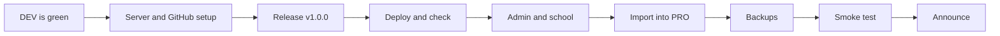

# First deploy to PRO

A one-time runbook to put the first version of Signa on `signa.arnedb.be`, with the class
videos from the old app, a first admin and daily backups (milestone 7 in
[PLAN.md](PLAN.md)). After this, PRO follows the normal flow in [DEPLOY.md](DEPLOY.md):
publish a release, it goes out the next night.

> **Real class videos never go to DEV.** Anyone can log in to DEV with the demo accounts from
> the README, and `admin` / `demo-admin` is a superadmin who sees every school. So the legacy
> import is tried and done on PRO only (step 6), with a backup first. Until the launch only
> you and the teacher have an account on PRO.

Plan about two hours, most of it the video import. Do it on a day without class: the old app
is stopped before the import (step 6), so students have no app until the launch (step 9).



In the commands below, the server folder is `/opt/sites/signa` (the `DEPLOY_PATH`) and the
old app lives in `/opt/sites/vgt`. Change them if yours differ.

The server commands use two shell shortcuts, `dev` and `pro`, for the full `docker compose`
command of each environment (`pro exec signa signa backup` is
`docker compose -p signa-pro --env-file … -f … exec signa signa backup`). Log in as the deploy
user (`ssh deploy@<server>`) and add them to `~/.bashrc` once, so every later login has them:

```bash
cat >> ~/.bashrc <<'EOF'
dev() { docker compose -p signa-dev --env-file /opt/sites/signa/.env.dev -f /opt/sites/signa/compose.yaml "$@"; }
pro() { docker compose -p signa-pro --env-file /opt/sites/signa/.env.pro -f /opt/sites/signa/compose.yaml "$@"; }
EOF
source ~/.bashrc
```

They work from any folder. `pro` needs `compose.yaml`, which the first deploy copies to the
server, so `pro` only works from step 4 on.

## 1. Choose the commit and check DEV

PRO only takes an image that already ran in DEV, and only a commit on `main` with green CI.

1. Make sure everything for the launch is merged to `main`.
2. *Actions → CI* and *Actions → Deploy* are green for the newest commit on `main`.
3. Note the commit DEV runs:

   ```bash
   curl -s https://signa-dev.arnedb.be/api/v1/health
   ```

   `release` is the commit SHA. This is the commit you will release. It must include the
   importer fix for old databases without a `year` column
   ([#17](https://github.com/arnedb/signa/pull/17), merge commit `a9d93fd`), so use
   `a9d93fd` or a newer commit; an older one stops the import with
   `No table with guid, word, year, list_number, video_file found`.
4. Click through DEV once: log in as `docent` / `demo-docent`, open a word, play a video,
   practise a list as `student` / `demo-student`.

## 2. One-time setup for PRO

Follow [DEPLOY.md → One-time setup](DEPLOY.md#one-time-setup). For PRO in particular, check:

- [ ] DNS: `signa.arnedb.be` points to the server (`dig +short signa.arnedb.be`).
- [ ] `.env.pro` exists in the deploy folder. The first time, `deploy/env.pro.example` is not on
      the server yet, so copy it from this repository:

      ```bash
      scp deploy/env.pro.example deploy@<server>:/opt/sites/signa/.env.pro
      ```

      Check `SIGNA_HOST=signa.arnedb.be` and `SIGNA_SEED_DEMO=false`. The Traefik settings
      are the same as in `.env.dev`.
- [ ] The server can pull the image: the `signa` package is public, or the deploy user ran
      `docker login ghcr.io`. If DEV deploys work, this is already done.
- [ ] GitHub → *Settings → Environments → `pro`* exists, with:
  - deployment branches and tags limited to `main` and `v*`;
  - required reviewers: yourself (recommended for the first deploy, remove later if you want
    unattended nightly deploys);
  - variables `SIGNA_HOST=signa.arnedb.be`, `DEPLOY_HOST`, `DEPLOY_USER`, `DEPLOY_PATH`;
  - secrets `DEPLOY_SSH_KEY` and `DEPLOY_KNOWN_HOSTS` (the same values as in `dev` if both run
    on one server).

## 3. Publish the first release

Use `v1.0.0` for the launch. Tag the commit from step 1, which already runs in DEV:

```bash
gh release create v1.0.0 --target <sha from step 1> --title "v1.0.0" \
  --notes "First version on signa.arnedb.be."
```

Or in GitHub: *Releases → Draft a new release*, new tag `v1.0.0`, target: that commit,
**Publish release** (not a draft, not a pre-release).

> The version number in the app (`version` in `/api/v1/health`) comes from
> `apps/api/src/signa/__init__.py` and still says `0.1.0`. That is fine: PRO is identified by
> the commit in `release`. If you want them to match, bump it to `1.0.0` in a commit first,
> wait until that commit runs in DEV, and release that commit instead.

## 4. Deploy and check

Do not wait for the night; start it now:

```bash
make deploy-pro REF=v1.0.0
```

Then in *Actions → Deploy*:

1. `resolve` finds the commit, checks that it is on `main` and that CI passed.
2. `image` finds the existing image (it does **not** build).
3. `deploy` waits for your approval → **Review deployments → Approve**.
4. `deploy` runs `deploy.sh` on the server and checks the public URL.
5. `tag` marks the image as `:pro`. From now on the nightly run sees that PRO runs `v1.0.0` and
   does nothing until there is a newer release.

On the first deploy there is no running container yet, so there is no backup and no
previous image to roll back to. That is expected.

Check it yourself:

```bash
curl -s https://signa.arnedb.be/api/v1/health
```

It must show `"environment": "pro"` and the commit SHA from step 1. In the browser there is
no yellow “Testomgeving (DEV)” bar and no `[DEV]` in the tab title.

**If it fails:** the workflow log and `pro logs --tail 100 signa` on the server show why.
Nobody uses PRO yet, so there is no rush: fix the cause and run `make deploy-pro REF=v1.0.0`
again. To take PRO offline meanwhile: `pro down` (the data volume stays).

## 5. First admin and school

On the server:

```bash
pro exec signa signa create-admin <your username>
```

It asks for a password and prints a **recovery code**: store it in your password manager.

Create the school, with its short name (`--slug`) and its first admin (the teacher; a new
account gets a temporary password, printed once):

```bash
pro exec signa signa create-org "<school name>" --slug <short name> --language vgt --admin <teacher username>
```

Log in on `https://signa.arnedb.be` as the superadmin and check *Beheer → Scholen*.

## 6. Import the old app into PRO

The import converts every old video, which takes time and can find problems in the old data.
The backup, the dry run and the report below let you check it before anything changes.

First stop the old app completely, flashcards and manager. Nobody can change the lexicon
after this, so PRO gets exactly what is on disk. Its login passwords are also in the `vgt`
repository's history, so it must not run again on the internet:

```bash
cd /opt/sites/vgt && docker compose down
```

`docker compose down` removes only the containers; the `lexicon` folder stays. Then:

```bash
pro exec signa mkdir -p /data/legacy
docker cp /opt/sites/vgt/lexicon/. "$(pro ps -q signa)":/data/legacy/
pro exec signa signa backup --label before-import
pro exec signa signa import-legacy /data/legacy/lexicon.db /data/legacy \
  --org <short name> --dry-run --report /data/import-report.md
pro exec signa cat /data/import-report.md
```

`--report` must point into `/data`: it is the only folder the app user may write to.

Read the report carefully: it lists every word with a missing video file or without a name.
Those words are imported without a clip or skipped; note them to fix in Signa afterwards (the
teacher uploads the missing clips in the word editor). Then run it for real:

```bash
pro exec signa signa import-legacy /data/legacy/lexicon.db /data/legacy \
  --org <short name> --report /data/import-report.md
```

- Add `--draft` if the teacher wants to check the words before students see them; they
  publish them in the word editor.
- If it stops halfway, run the same command again: words that were already imported (by
  their old `guid`) are skipped.
- To start over completely: stop the container, restore the `before-import` backup (see
  [DEPLOY.md → Backups](DEPLOY.md#backups)), start it again.

Keep the report (`docker cp "$(pro ps -q signa)":/data/import-report.md .`), log in as the
superadmin and check some words and videos of each year and list, then remove the copied
files. The originals stay in `/opt/sites/vgt`:

```bash
pro exec -u root signa rm -rf /data/legacy
```

## 7. Backups

Every deploy makes a backup, but a release can be weeks apart. Add the daily backup as the
deploy user (`crontab -e`):

```cron
15 3 * * * cd /opt/sites/signa && docker compose -p signa-pro --env-file .env.pro -f compose.yaml exec -T signa signa backup --label daily
```

Run the command once by hand and check that a file appears:

```bash
pro exec signa ls -l /data/backups
```

The backups are inside the same volume as the database, so they do not survive a lost
server. Also copy `/data/backups` and `/data/media` off the server regularly (for example
with `rsync` or `restic` from the volume folder; `docker volume inspect signa-pro_data`
shows where it is).

## 8. Smoke test as each role

On a phone and on a laptop:

- [ ] **Superadmin:** log in, see the school under *Beheer → Scholen*.
- [ ] **Teacher:** log in with the temporary password, change it, make a group per class
      (“Jaar 1 · dinsdag”, …), copy each group's invite link.
- [ ] **Student:** open an invite link in a private window, make an account, practise a list
      in both directions, play videos (also seeking in a video), report a video.
- [ ] **Teacher:** see the report under “Meldingen”, resolve it.
- [ ] **Uploads:** upload one clip in the word editor and wait until it is converted.

## 9. Launch

1. Send each group its invite link. Tell the students that progress from the old app is not
   carried over (it lived only in their browser).
2. Keep `/opt/sites/vgt/lexicon` as an archive, but do not start the old app again. If PRO has
   a problem, roll back PRO instead (see [DEPLOY.md → Day to day](DEPLOY.md#day-to-day)).
3. Mark milestone 7 as done in [PLAN.md](PLAN.md).

## After the launch

New versions go out the normal way ([DEPLOY.md → Day to day](DEPLOY.md#day-to-day)): merge
to `main`, check DEV, publish a release `v1.0.1`, `v1.1.0`, … It is deployed the next night,
after your approval if the `pro` environment still has required reviewers.
